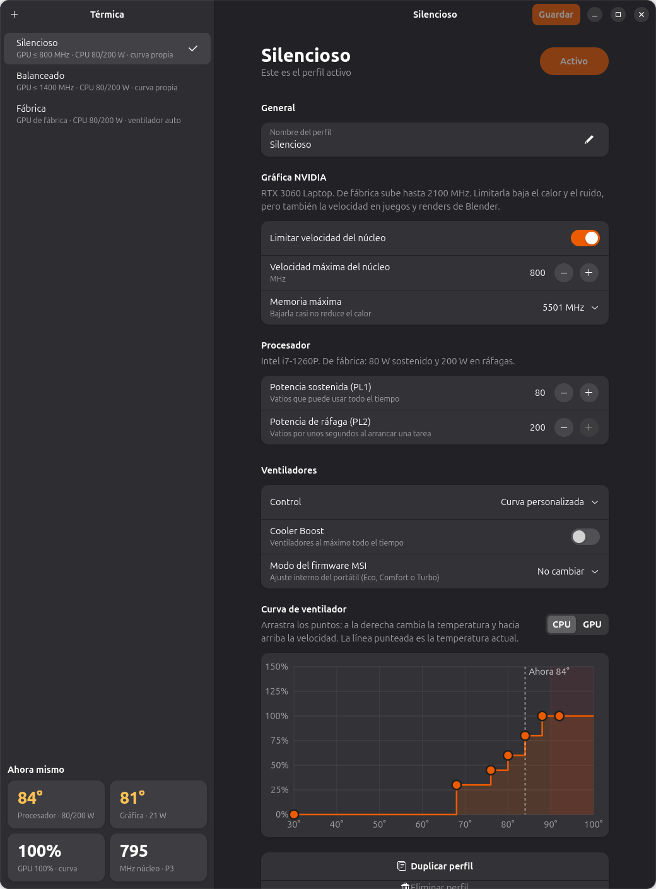
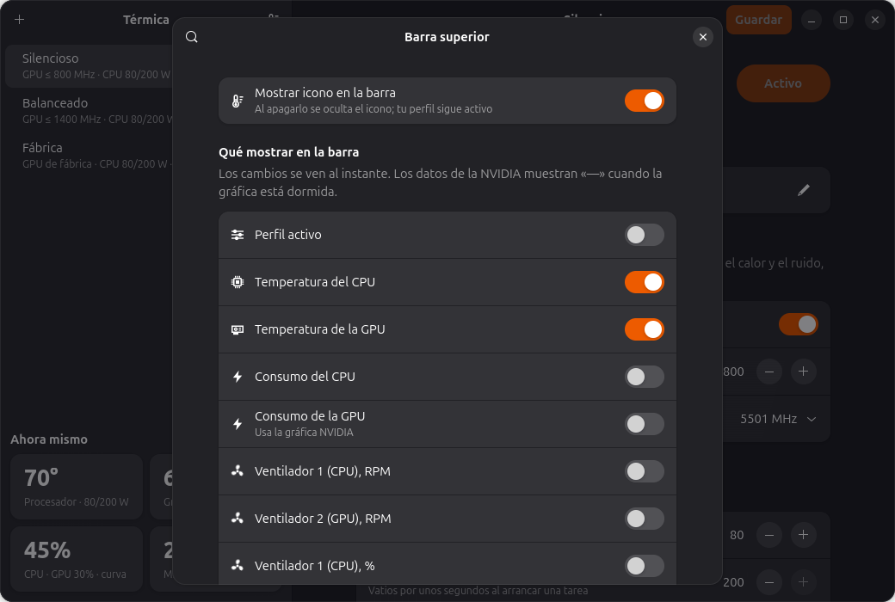
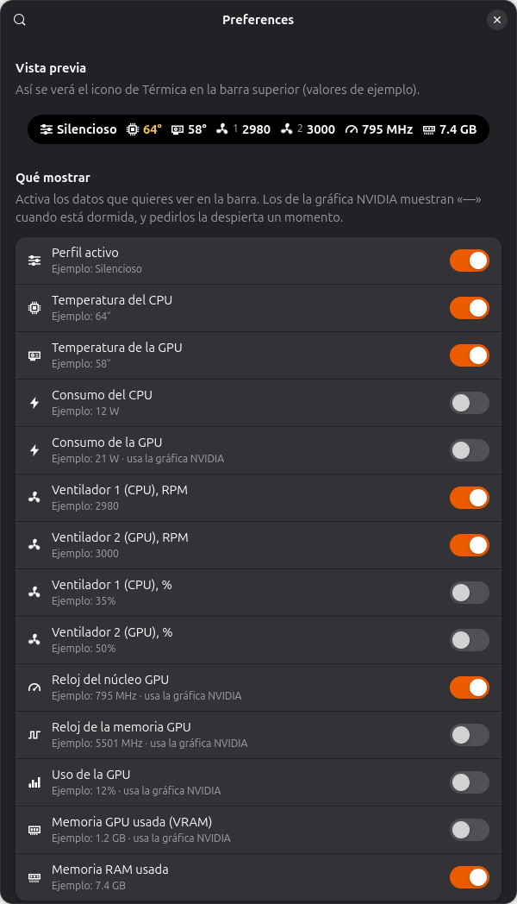

# Térmica

Thermal profiles for **MSI** laptops with **NVIDIA** graphics on **Ubuntu / GNOME**.
Switch GPU clock limits, CPU power, Turbo Boost and fan curves with one click, and monitor temperatures,
RPM, clocks and memory live from the top bar.



## Features

| Component | Purpose |
|---|---|
| **`termicad` service** (Rust, root, systemd) | Applies hardware profiles through a system bus API (`com.ikario.Termica1`). Reapplies them at startup, after suspend, when the GPU wakes and when NVIDIA loses its clock limit. Uses about 10 MB of RAM. |
| **Térmica app** (Rust, GTK4 + libadwaita) | Creates, edits, duplicates and deletes profiles. Includes a draggable fan curve editor and live temperatures. |
| **GNOME Shell extension** | Top bar metrics of your choice (temperatures, RPM, clocks, VRAM, RAM, power…), profile switching, Cooler Boost and Turbo Boost. |

Each profile controls:

- **NVIDIA GPU:** maximum core and memory clocks through NVML, NVIDIA's official library.
- **Intel CPU:** sustained and burst power (PL1/PL2 through RAPL) and Turbo Boost.
- **MSI fans:** factory automatic mode or custom CPU/GPU curves, Cooler Boost and firmware mode (Eco/Comfort/Turbo). Comfort caps fan speeds at about 4200 rpm on the Stealth 15M even when the curve requests more; Turbo has no cap.
- **Automatic Cooler Boost:** runs briefly when the CPU or GPU reaches a threshold (83 °C by default), then stops a few seconds after temperatures drop below it.

Three example profiles are included: **Quiet**, **Balanced** and **Factory**. Existing saved profile names and IDs are preserved when updating.

### Language

English is the default. Choose **Language → English / Spanish / System** from the app menu, or use the
**Language** selector in the extension preferences. **System** uses Spanish for Spanish locales and English
for other locales. The preference is shared by the app and extension and stored in
`$XDG_CONFIG_HOME/termica/language` (normally `~/.config/termica/language`).

Use **Restart Térmica** in the app menu to apply a language change, then reopen extension preferences.
Restarting first restarts `termicad` and reapplies the saved active profile, then reopens the app.
System authorization may be requested. If restarting the service fails, the app stays open and shows the error.
The app asks before discarding unsaved profile changes; temporary Cooler/Turbo Boost overrides reset when the service restarts. The extension menu updates
the next time it opens. Profile names are user data and are not translated automatically.
Desktop launcher descriptions and authorization prompts follow the system language.

### Top bar

Choose metrics from the app's thermometer button or the top bar menu; each metric has its own icon:



You can also use the extension preferences. Metric changes appear immediately:



The screenshots show an earlier Spanish interface.

## Compatibility

Tested on:

- **MSI Stealth 15M B12UE** (MS‑15B1 board, EC firmware `15B1EMS1.102`)
- Ubuntu 26.10, GNOME Shell 51, GTK 4.24, libadwaita 1.10
- NVIDIA driver 580 (RTX 3060 Laptop)

> The fan curve is written directly to the laptop's embedded controller (EC), and addresses depend on
> the model. For safety, the service **only writes curves when firmware starts with `15B1EMS1`**.
> Other models can use the remaining GPU, CPU, fan mode and Cooler Boost controls through `msi-ec`.
>
> If you have verified that your model uses the same addresses (`0x6A`/`0x72` CPU, `0x82`/`0x8A` GPU),
> you can allow writes at your own risk with `sudo touch /etc/termica/allow-unknown-ec`.

## Requirements

- Ubuntu with GNOME Shell 51 (the version declared by the extension).
- Proprietary NVIDIA driver (`nvidia-smi`).
- `msi_ec` and `ec_sys` kernel modules. The service loads them automatically, with `write_support=1` for `ec_sys`.
- **Secure Boot disabled**, or a kernel without lockdown: lockdown prevents EC writes.
- Build dependencies:

```sh
sudo apt install cargo rustc build-essential pkg-config libgtk-4-dev libadwaita-1-dev
```

Rust 1.92 or later (Ubuntu 26.10 ships 1.97).

If `msi_ec` does not recognize your firmware, you may need to force a compatible version, for example:

```sh
echo 'options msi_ec firmware=15B1EMS1.103' | sudo tee /etc/modprobe.d/msi_ec.conf
```

## Installation

```sh
git clone https://github.com/acid0ikario/termica.git
cd termica
./install.sh
```

The first build takes a few minutes. Then **sign out and back in** so GNOME loads the extension.
On Wayland, extensions cannot be reloaded without restarting the session.

The installer:

1. Builds in release mode, installs `/usr/local/libexec/termicad`, registers the systemd service and starts it.
2. Installs the D-Bus policy and `com.ikario.termica.manage` polkit action. An active local user can change profiles **without a password**.
3. Installs `/usr/local/bin/termica`, its icon and desktop launcher.
4. Copies and enables the extension at `~/.local/share/gnome-shell/extensions/termica@ikario`.
5. Disables an older `msi-fan-curve` service if present and removes leftovers from the Python 0.1 version.

To update: `git pull && ./install.sh`.

Profiles are saved in `/etc/termica/profiles.json`. The active profile persists across restarts.

## Usage

- **Switch profiles:** top bar menu → *Profiles*, or **Activate** in the app.
- **Edit profiles:** use the Térmica app. Saving the active profile applies the changes immediately.
- **Quick Cooler Boost / Turbo Boost:** use the top bar switches. These settings last until the next profile change; save them in a profile to make them permanent.
- **Choose top bar metrics:** app → thermometer button, top bar menu → *Show in top bar*, or Extensions → Térmica → ⚙.
- **Hide the icon:** top bar menu → *Quit Térmica*. The profile stays applied. Show it again with app → thermometer button → *Show icon in top bar*.

### Value validation

The service rejects unsafe profiles: decreasing fan speeds as temperature increases, a final speed below
70, unordered temperatures, PL2 below PL1, or values outside supported ranges.

## Uninstall

```sh
./uninstall.sh
```

Removes the service, app and extension, and re-enables `msi-fan-curve` if it existed.
Profiles remain in `/etc/termica/profiles.json`.

## Development

Test without changing hardware or installing anything: `--dev` uses the session bus, skips authorization
and only logs the settings it would apply.

```sh
mkdir -p /tmp/termica-dev
TERMICA_CONF_DIR=/tmp/termica-dev cargo run -p termicad -- --dev &
TERMICA_DEV=1 cargo run -p termica
```

Tests and analysis: `cargo test` and `cargo clippy --all-targets`.

D-Bus API (`com.ikario.Termica1` at `/com/ikario/Termica1`):

| Method | Description |
|---|---|
| `GetProfiles() → s` | JSON profiles and active profile |
| `GetStatus() → s` | Full status, including NVIDIA metrics when the GPU is awake |
| `GetTemps() → s` | Lightweight sysfs status without waking the GPU |
| `Activate(s id) → s` | Activates a profile; returns warnings for failed components |
| `SaveProfile(s json) → s` | Creates or replaces a profile |
| `DeleteProfile(s id)` | Deletes an inactive profile |
| `RestoreDefaults(s id)` | Restores one bundled profile, or all three with `""` |
| `SetQuick(s key, b value)` | Temporarily changes `cooler_boost` or `turbo` |

Signals: `ActiveChanged(s)`, `ProfilesChanged()`, `QuickChanged(s, b)`.

```
crates/termica-core/  shared profile types and validation
crates/termicad/      service (zbus, tokio, nvml-wrapper)
crates/termica/       app (gtk4-rs, libadwaita-rs)
extension/            GNOME Shell extension (GJS)
data/                 systemd, D-Bus, polkit, launcher, icon and default profiles
```

In development mode (`TERMICA_DEV=1`), restarting the app leaves the system service untouched.

English strings live in the UI code; Spanish translations are shared in
`extension/termica@ikario/es.json`. The app embeds this catalog at build time, and the installer copies it
alongside the extension. Formatted Rust messages use `trf!` with both language variants.

Version 0.1 was written in Python and remains in git history under the `v0.1-python` tag.

## License

[GPL-3.0](LICENSE)
